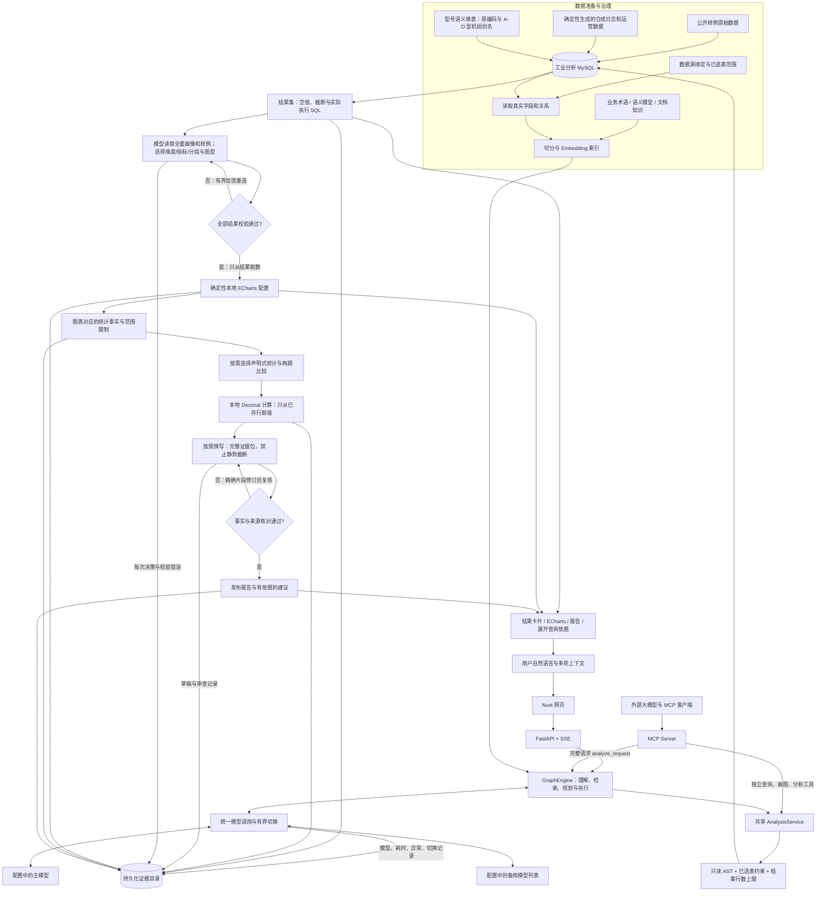
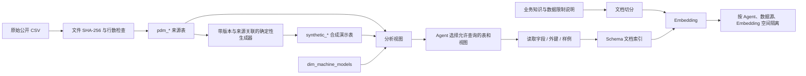
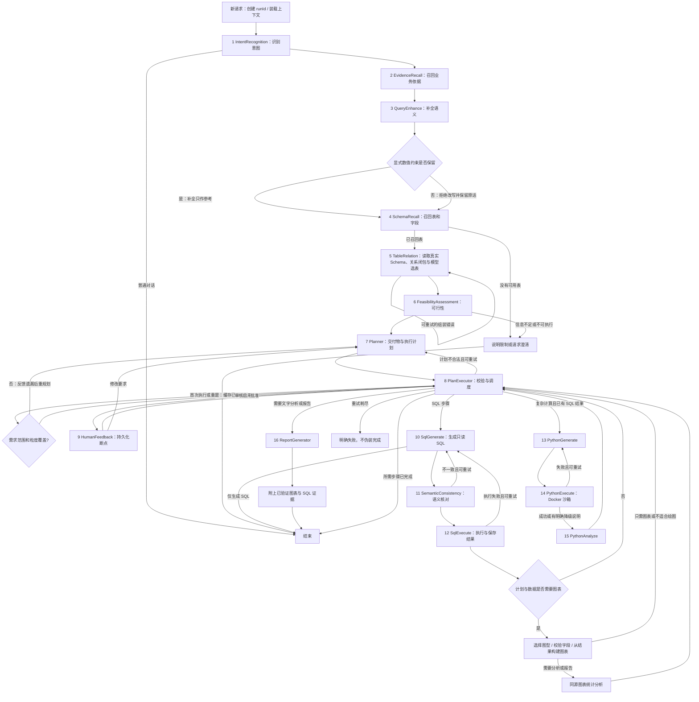
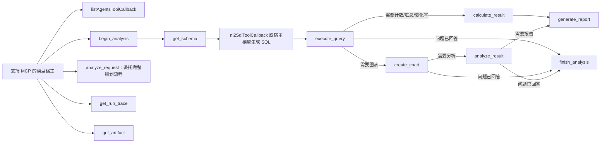
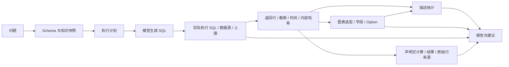
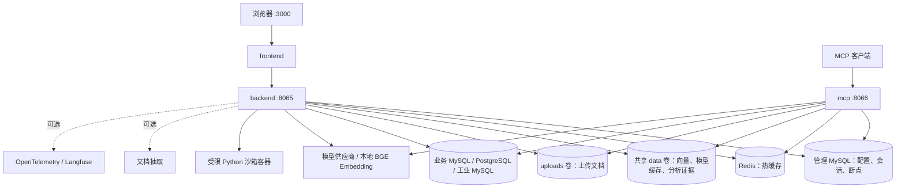

# DataAgent-Python 全项目流程图

更新：2026-09-18。以当前 Python 实现为准；Java 上游审计资料仅用于迁移历史对照。

## 1. 全局：从数据到回答

这里存在两个入口，但不是两套业务逻辑。网页直接调用共享 Python 服务；外部模型通过 MCP 调用相同服务。网页内部没有为了使用 MCP 而绕回本机网络，也不宣称每个节点都经过 MCP。

当前是**模型规划 + 显式执行器**，不是任意代码自由执行的 Agent。安全规则固定，问题意图、计划步骤、展示类型和文字分析由模型结合上下文选择。更换数据源不需要硬编码一批问题与答案。

备用模型只在配置的同一 CHAT 接口内，因网络/超时或服务暂不可用而有界切换；SQL 错误不触发切换，已交付流不重放，向量模型不参与。每次尝试本地留存 `model_call`，失败节点留存 `node_error`，不依赖外部监控平台。策略与实测范围见 [MODEL_FALLBACK.md](MODEL_FALLBACK.md)。

## 2. 数据准备、索引和命名

- `pdm_*` 表示本项目保留的来源数据，不等于已经验证的真实工厂现场记录。
- `synthetic_*` 是用于演示的生成数据，包括日志、工单、成本、产量和 OEE；不能作为真实业务收益或事故根因的证据。
- `model1`～`model4` 是匿名设备型号类别，**不是大模型名称**，也不是单台设备编号。显示为 A～D 型机组并保留原编码，不虚构厂商、规格或性能等级。
- `machineID` 才标识单台设备。模型配置页的 CHAT/EMBEDDING 是另外一套概念。
- 工业包中的参考 SQL 和独立演示脚本可用于对照；其执行成功不等于网页已经完成了真实自然语言生成 SQL。二者要分别验证。

## 3. 运行时完整节点与分支

报告不再是每次查询的强制最后一步。正常问题的交付物由规划器推断：单值/明细可只返回结果；比较/趋势可生成图表；需要解释或决策时再生成文字分析与建议。

执行步骤和结果通过 SSE 展示；报告正文先完成生成及图表替换，再发布，避免模型临时生成的图表数值进入页面。暂停/恢复依赖持久化 checkpoint；用户停止与异常不是业务成功。

用户原话始终是权威输入，不被模型补全替代。通用数值约束检查会拒绝遗漏/改变显式年份、数量等的改写，并保存被拒绝的提案；该检查不是完整语义证明，SQL 语义核对仍同时看到原话和补全建议。必要图表失败会保存非空原因，运行标记为 `partial`，不冒充完整成功。

## 4. MCP 工具边界

| 工具 | 输入依据 | 返回内容 |
|---|---|---|
| `listAgentsToolCallback` | 状态、关键词 | 可用智能体 |
| `begin_analysis` | agentId、自然语言问题 | runId 与问题证据 |
| `get_schema` | agentId，可选 runId | 真实 Schema、内容版本，可保存快照 |
| `nl2SqlToolCallback` | 问题、agentId | SQL 文本，不执行查询 |
| `execute_query` | runId、只读 SQL | 结果、实际执行 SQL、截断和证据编号 |
| `create_chart` | 已存结果编号、图型和字段 | 可渲染 ECharts Option 与图表证据，不接收模型编造的数值数组 |
| `analyze_result` | 同源结果与图表编号 | 确定性统计事实、空值、范围说明；不自动证明因果 |
| `calculate_result` | 已存结果编号、分组/过滤/计算声明 | 本地精确计数、求和、均值、极值、两期差值和变化率；保留原结果引用 |
| `generate_report` | runId、分析重点 | 模型文字解读 + 已验证图表 + SQL 证据附录 |
| `finish_analysis` | runId | 无需报告时正常结束 |
| `analyze_request` | 自然语言、agentId | 与网页相同的完整规划流程 |
| `get_run_trace` | runId | 工件清单、步骤、耗时、依赖与状态 |
| `get_artifact` | runId、artifactId | 校验哈希后的 SQL/结果/图表/报告 |

默认 Streamable HTTP：`http://127.0.0.1:8066/mcp`。MCP 客户端必须提供受保护智能体的 `apiKey`，与网页使用同一验证逻辑。

已实现的图型：纵向柱状、横向条形、折线、饼图、散点、热力图、堆叠柱状。适用性和字段要校验；重复类别不静默合并，空值不替换为 0。返回的是图表配置，**不是图像文件，也不是截图视觉理解结果**。当前分析读取图表所对应的结构化数据和统计特征。

可选第三方：[AntV Chart MCP](https://github.com/antvis/mcp-server-chart)。官方默认请求在线绘图服务，可另行私有部署。本项目本轮不接入该远程服务、不发送工业行数据给它。将来接入也应由本项目根据结果编号取数，第三方只承担渲染。

## 5. 可追溯证据链

存储位置为 `DATAAGENT_VECTOR_FILE_PATH` 同目录的 `analysis-runs/<runId>/`，Compose 默认 `/app/data/analysis-runs/`，由 backend 与 MCP 共享卷持久化。JSON 内容使用 SHA-256、父工件编号、原子写入和跨进程锁；HTTP 与 MCP 读取时校验所属 Agent 和内容哈希。

查询证据中的 SQL 是带系统行数保护的实际执行语句，另存模型原始请求 SQL。系统多取一行判定截断，只展示设定上限内的行。查询中的业务 `LIMIT`、过滤条件和聚合范围仍决定数据含义；`truncated=false` 不代表覆盖整个数据库。

API：

- `GET /api/analysis/runs/{runId}?agentId=...`
- `GET /api/analysis/runs/{runId}/artifacts/{artifactId}?agentId=...`

证据链证明“本次输出依赖哪些已保存的输入”，不是不可伪造的数字签名，也不证明模型结论正确或数据库此刻未变化。文件可被系统管理员连同清单一起改写；生产级不可抵赖审计需要独立签名/审计存储。

## 6. 部署与支撑服务

管理库与分析数据源不是同一个库。工业演示包保留独立 MySQL 容器与数据卷，不在应用镜像内重复打包大数据集。`.dockerignore` 排除 examples、work、data、uploads 与测试临时输出。

数据库账户仍应使用最小只读权限；SQL AST 和超时限制不能代替数据库权限。当前通用连接器的超时是应用侧等待期限，并不保证所有驱动能立即终止数据库端正在执行的查询。

## 7. 代码导航与验收

| 位置 | 职责 |
|---|---|
| `src/dataagent/workflow/engine.py` | 生命周期、SSE、断点、步骤证据 |
| `src/dataagent/workflow/nodes.py` | 16 个节点与模型规划调度 |
| `src/dataagent/analysis.py` | 网页与 MCP 共用的查询、图表、分析服务 |
| `src/dataagent/visualization.py` | 图型适用性、确定性 ECharts 与统计 |
| `src/dataagent/artifacts.py` | 证据存储、归属与完整性检查 |
| `src/dataagent/query_constraints.py` | 原始输入数值约束保护；不绑定具体年份、型号或问题 |
| `src/dataagent/mcp_server.py` | 13 个 MCP 工具 |
| `src/dataagent/calculations.py` | 通用声明式 Decimal 运算，不接受模型生成的答案数值或可执行代码 |
| `src/dataagent/reports.py` | 受证据约束的报告与安全导出 |
| `frontend/app/components/chat/ChatResultSet.vue` | 图表、表格、空值、截断与查询依据 |
| `examples/industrial-pdm/` | 原始/合成工业数据、生成器、知识与独立对照验证 |
| `tests/test_analysis_artifacts.py` | 证据、越权、7 种图型、MCP 工具链、自适应报告测试 |
| `tools/export_analysis_run.py` | 独立校验并导出证据；可附带本地前端资源以离线渲染 |

验收应分三层：离线回归检查契约和安全边界；真实模型测试检查自然语言生成 SQL；网页检查真实图表、来源展开和报告显示。测试中使用 mock 的结果不冒充真实大模型效果。运行记录与本轮验收结论见 `OPTIMIZATION_VERIFICATION.md`。
