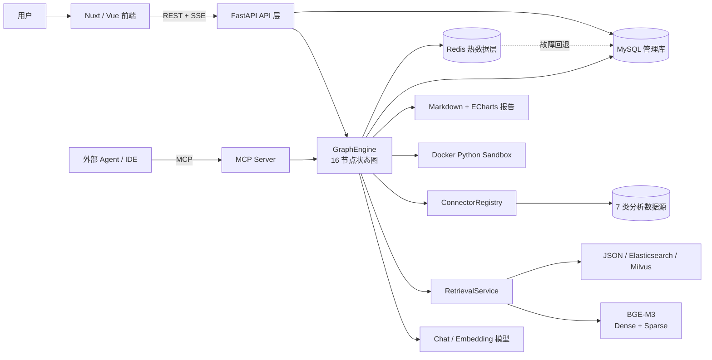
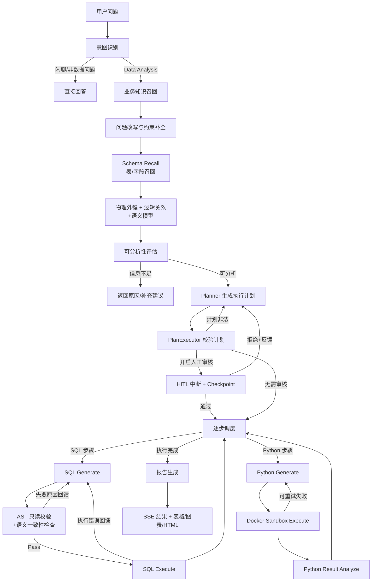
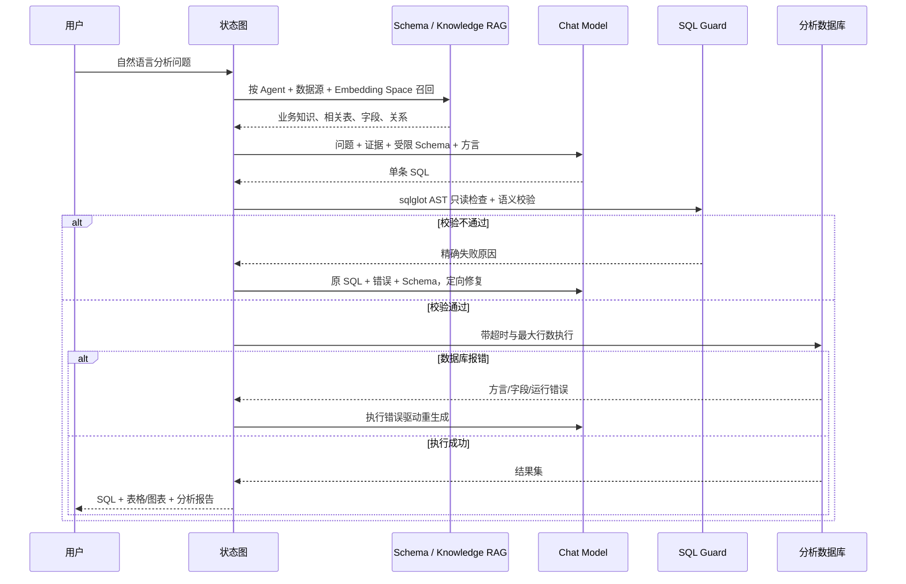
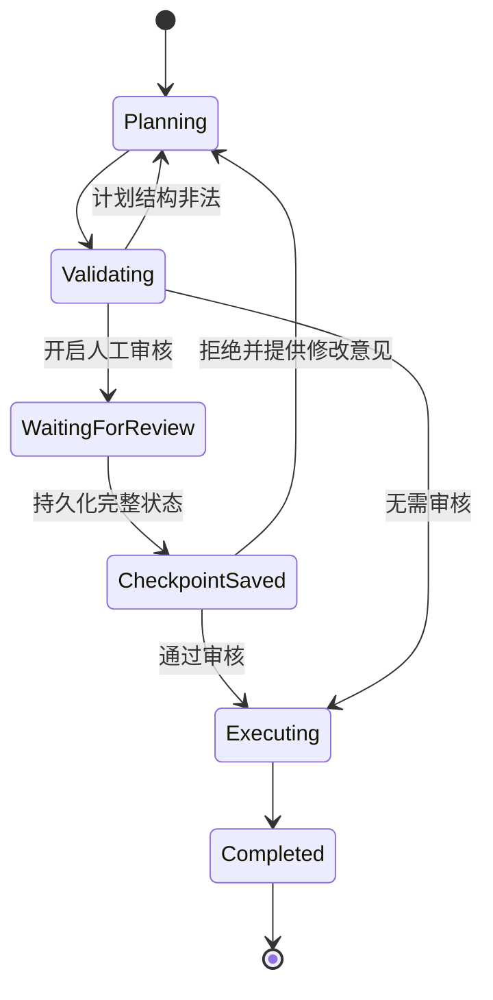
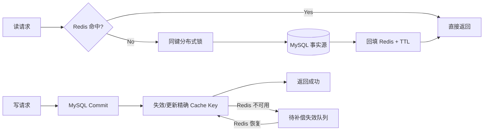
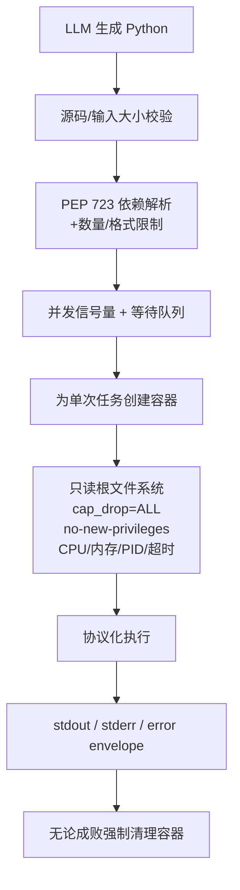

# 智能数据分析 Agent 平台：项目梳理与简历总结

## 1. 项目定位

这是一个面向企业数据分析场景的 Python Agent 平台。用户可以绑定业务数据源、配置语义模型与知识库，直接用自然语言提出分析问题。系统会自动完成意图识别、知识召回、Schema 检索、任务规划、SQL 生成与纠错、Python 深度分析、人工审核和可视化报告生成。

项目不是简单的「LLM 生成 SQL」，而是把模型推理、工具执行、安全校验、错误反馈、状态恢复和前端实时交互组成可持续运行的工程系统。

## 2. 技术栈

| 领域 | 技术 |
|---|---|
| 后端 | Python 3.11、FastAPI、Uvicorn、Pydantic 2 |
| Agent 编排 | 异步显式状态图、16 个执行节点、39 个状态字段、条件路由 |
| 数据持久化 | SQLAlchemy 2 Async、MySQL / SQLite、Redis |
| RAG | BGE-M3、Dense + Sparse Embedding、RRF、Simple JSON / Elasticsearch / Milvus |
| Text-to-SQL | Schema Recall、语义模型、sqlglot AST 校验、错误反馈重试 |
| 数据源 | MySQL、PostgreSQL、H2、Dameng、SQL Server、Oracle、Hive |
| Python 执行 | Docker SDK、任务级容器隔离、CPU/内存/PID/超时限制 |
| 模型接入 | OpenAI-compatible Chat / Embedding、数据库热配置、本地 GPU BGE-M3 |
| 前端 | Nuxt 4、Vue 3、Pinia、Vuetify、ECharts |
| 通信 | REST、SSE、MCP Streamable HTTP / SSE / stdio |
| 观测 | OpenTelemetry、Langfuse OTLP、节点级 Trace |
| 工程化 | Docker Compose、Pytest、Ruff、Vitest、Python wheel/sdist |

## 3. 总体架构图

### 各层职责

- 前端层：管理 Agent、数据源、知识、语义模型和模型配置，通过 SSE 实时展示节点进度、SQL、表格、图表和报告。
- API 层：提供 100+ 个业务操作，负责参数校验、权限验证、错误封装和资源管理。
- Agent 层：使用显式状态图管理模型推理、工具调用、重试、中断与恢复。
- 数据层：MySQL 保存持久化事实，Redis 承担高频会话和状态读取，向量库存储 Schema 与业务知识。
- 执行层：数据库连接器只执行校验后的查询，生成的 Python 代码只在受限 Docker 容器中执行。

## 4. Agent 主流程图

## 5. Text-to-SQL 闭环

这条链路解决了三个关键问题：

1. 不把整库 Schema 全部塞给模型，而是先召回再构造最小必要上下文。
2. 不直接信任模型生成的 SQL，而是同时做 AST 级安全校验和 Schema 语义校验。
3. 失败时不是简单「再试一次」，而是将语义失败、数据库执行错误和原 SQL 定向反馈给修复 Prompt。

## 6. RAG 与 Schema 理解

检索上下文由四类信息共同组成：

- Schema 文档：表名、字段、类型、注释、样例值和取值范围。
- Semantic Model：业务名、同义词、业务含义和字段映射。
- Business Knowledge：口径、规则、指标定义和文档证据。
- Agent Knowledge：面向特定 Agent 的指令、偏好和领域约束。

技术要点：

- BGE-M3 在 GPU 上产生 1024 维 dense 向量和 lexical sparse 向量。
- Milvus 模式可使用 dense+sparse 双路召回与 RRF 排序；另外的关键词检索分支可降级，Dense 主检索失败则明确报错，不伪造结果。
- 检索条件同时限定 Agent、数据源、向量类型和 `embeddingSpaceId`，避免跨租户、跨数据源和跨模型污染。
- 切换 Embedding 模型时先在候选向量空间重建有效资源，全部成功后再切换活跃模型，避免新旧向量混用。

## 7. Human-in-the-loop 与可恢复执行

- 中断时保存完整 Agent State、当前节点、`threadId`、`conversationId` 和 Agent 归属。
- 恢复时先校验 Agent 与会话归属，防止利用其他会话的 `threadId` 读取或删除 checkpoint。
- 审核通过后从原节点继续；拒绝时将人工意见注入 Planner 重新规划，而不是整条任务从头丢失。

## 8. Redis 会话记忆与 MySQL 持久化

缓存对象包括：

- Agent 会话列表和消息记录。
- 经 Token 预算裁剪后的多轮上下文。
- Human-in-the-loop 图执行 checkpoint。

一致性原则是「数据库先提交，缓存后更新」。MySQL 始终是事实源；Redis 断开时系统自动回退 MySQL，并在健康接口中显示降级状态。同键锁用来避免缓存击穿和旧值回填覆盖新值。

## 9. Python Sandbox 安全模型

该设计避免在 FastAPI 进程内执行不可信代码，同时通过结果协议稳定区分业务输出、Python 运行错误、超时和沙箱协议错误。代码失败会进入最多 5 次的反馈修复；最终失败时降级到文本分析，避免整份报告直接中断。

## 10. 其他关键工程设计

### 10.1 上下文治理

- 多轮会话同时受「最近轮数」和 Token 预算限制，优先保留最新完整轮次。
- 所有 Chat 调用都通过统一 Token 预算门，安全指令优先级高于任务数据。
- 超长输入采用首尾保留裁剪；如果模型服务仍返回上下文溢出，在产生任何输出前按比例缩减并重试。
- 实测可将保守估算约 300,068 Token 的输入在发送前压缩到 28,144 Token。

### 10.2 模型管理

- Chat 与 Embedding 模型可通过管理 API 热配置，支持连通性检测、激活切换和密钥掩码。
- 模型密钥不返回明文，用户回传掩码时不会覆盖原密钥。
- 本地 BGE-M3 可在 NVIDIA GPU 上以 FP16 运行，减少 Schema/知识入库与检索时的 Embedding 延迟。

### 10.3 实时交互与报告

- 每个节点产生统一 SSE 事件，前端可展示节点名、输出类型、错误状态、SQL、Python、结果集和最终答案。
- SQL 结果会根据字段特征推荐 table / column / bar / line / pie 展示方式。
- 报告使用 Markdown + ECharts JSON；模型不能直接注入任意 JavaScript，HTML 渲染前进行危险标签、事件属性和 URL 清理。

### 10.4 MCP 对外能力

- `listAgentsToolCallback`：让外部 Agent 发现已配置的数据分析 Agent。
- `nl2SqlToolCallback`：使用指定 Agent 将自然语言查询转换为只读 SQL。
- 支持 Streamable HTTP、SSE 和 stdio，可被 IDE、桌面客户端或其他 Agent 调用。

## 11. 代码模块梳理

| 模块 | 职责 |
|---|---|
| `src/dataagent/app.py` | FastAPI 生命周期、依赖装配、路由、异常、CORS 与健康检查 |
| `src/dataagent/api/` | Agent、数据源、知识、语义模型、模型配置、会话与 Graph API |
| `src/dataagent/workflow/state.py` | 节点名称、状态字段和初始状态 |
| `src/dataagent/workflow/nodes.py` | 16 个 Agent 节点、路由、重试与工具闭环 |
| `src/dataagent/workflow/engine.py` | SSE 驱动、中断/恢复、checkpoint、取消和多轮历史 |
| `src/dataagent/llm.py` | Chat/Embedding 调用、结构化输出修复、Token 预算和模型热配置 |
| `src/dataagent/vectorstore.py` | 向量后端、元数据过滤、Dense/Sparse 召回与 RRF |
| `src/dataagent/schema_index.py` | Schema 文档生成与 Agent/数据源索引 |
| `src/dataagent/documents.py` | 文件上传、抽取、切分、存储和知识向量生命周期 |
| `src/dataagent/connectors.py` | 7 类数据源的连接、元数据、DDL 与只读查询 |
| `src/dataagent/sandbox.py` | Docker 代码沙箱、依赖解析、资源限制与结果协议 |
| `src/dataagent/memory_cache.py` | Redis 读穿缓存、分布式锁、精确失效、熔断与 MySQL 回退 |
| `src/dataagent/reports.py` | Markdown / ECharts 报告和安全 HTML 渲染 |
| `src/dataagent/mcp_server.py` | MCP 工具和多传输方式 |
| `src/dataagent/telemetry.py` | 图/节点/模型 Span、Token 与输入输出观测 |
| `frontend/` | Nuxt 管理端、会话页、SSE 渲染、图表与报告展示 |

## 12. 可写入简历的版本

### 项目名称

**智能数据分析 Agent 平台**

### 技术栈

Python、FastAPI、SQLAlchemy Async、Pydantic、MySQL、Redis、BGE-M3、Milvus/Elasticsearch、Docker、Nuxt/Vue、SSE、MCP

### 项目描述

面向企业多数据源场景的智能数据分析平台，用户通过自然语言即可完成 Schema 检索、Text-to-SQL、Python 深度分析与可视化报告生成，支持多轮记忆、人工审核、失败自动纠错、MCP 调用和多模型热配置。

### 项目亮点

- 设计 16 节点异步 Agent 状态图，将意图识别、RAG、任务规划、SQL/Python 工具执行、人工审核和报告生成组成可观测、可中断、可恢复的工作流。
- 实现 Schema + Semantic Model + Business Knowledge 多路 RAG，基于 BGE-M3 Dense/Sparse Embedding 和 RRF 混合检索，通过 Agent、数据源和 Embedding Space 元数据隔离避免知识串扰。
- 构建 Text-to-SQL 自动纠错闭环，使用 sqlglot 拒绝多语句和写操作，结合 Schema 语义校验、数据库错误反馈和最大重试次数，提升查询安全性与成功率。
- 设计任务级 Docker Python 沙箱，实现只读根文件系统、Capability 移除、禁止提权、CPU/内存/PID/超时限制与强制清理，隔离 LLM 生成代码对主服务的影响。
- 采用 MySQL + Redis 分层记忆，对会话、裁剪上下文和 HITL checkpoint 做读穿缓存、同键锁和事务后失效；Redis 故障时自动回退 MySQL 并补偿缓存失效。
- 通过 SSE 实时输出节点进度、SQL、Python、结果集和报告，并以 MCP 对外提供 Agent 发现与 NL2SQL 能力，便于接入 IDE 和其他 Agent 系统。
- 建立后端 96 项、前端 21 项自动测试及 Docker 真实链路烟测，覆盖 SSE、HITL、Redis 故障回退、GPU Embedding、MCP 和 Python Sandbox。

> 简历版面有限时，从上述亮点中选 4–5 条即可，优先保留「状态图、RAG + Text-to-SQL、Sandbox、Redis 记忆、真实链路验证」。

## 13. 面试口述版

### 30 秒版

我做的是一个 Python 数据分析 Agent 平台。它不是让大模型直接生成 SQL，而是用 16 节点状态图把意图识别、Schema 和业务知识 RAG、计划、SQL/Python 执行、失败纠错和报告生成组织起来。SQL 经过 AST 和语义双重校验，Python 只在受限 Docker 沙箱中执行。系统还支持 Redis 多轮记忆、Human-in-the-loop 恢复和 SSE 实时展示。

### 2 分钟版主线

1. 用户提问后，系统先做意图识别和问题改写，把多轮指代变成可独立检索的问题。
2. RAG 按 Agent 和数据源召回业务知识、表和字段，再合并物理外键、逻辑关系和语义模型，构造最小必要 Schema。
3. Planner 只能生成 SQL、Python 和 Report 三类工具步骤，PlanExecutor 对步骤和参数做结构校验，可选地在执行前进入人工审核。
4. SQL 经过只读 AST 校验、Schema 语义校验和真实执行，失败原因会回流到生成节点；Python 代码则放到单次 Docker 容器执行。
5. 每个节点通过 SSE 返回进度，最后生成表格、ECharts 图表和 HTML 报告。MySQL 负责持久化，Redis 优化会话与 checkpoint 读取，所以即使 Redis 临时异常也不会丢数据。

## 14. 面试高频追问要点

### 为什么不让 LLM 直接查数据库？

模型可能幻觉出不存在的表/字段、生成写操作或不符合当前方言的 SQL。因此系统只提供召回后的受限 Schema，并在执行前做 AST 只读校验与 LLM 语义校验，执行错误也会定向反馈修复。

### 为什么同时用 MySQL 和 Redis？

MySQL 提供可靠事务和持久化，Redis 用来降低会话、上下文和 checkpoint 的高频读延迟。写入必须先提交 MySQL，再失效 Redis；这样 Redis 可以降级，但不会成为第二个事实源。

### 如何处理上下文超限？

先限制历史轮数，再用 Token 预算优先保留最新完整轮次，对超长任务数据做首尾保留压缩。如果下游模型仍报 context overflow，只在尚未产生输出时按比例缩减重试，避免重复输出。

### 如何保证生成 Python 的安全？

不在 Web 服务进程中 `exec`，而是每次创建受限 Docker 容器；使用只读根文件系统、临时目录、Capability 移除、禁止提权和资源限制，并在 `finally` 中强制删除任务容器。

### 人工审核为什么能跨请求恢复？

因为中断点不只存在进程内存中，而是持久化了完整 State 和下一节点。后续请求使用同一 `threadId` 读取 checkpoint，完成 Agent/会话归属校验后再继续执行。

### 如何避免更换 Embedding 模型后检索错乱？

向量元数据中保存 `embeddingSpaceId`。切换前先在候选空间重建全部有效 Schema 和知识，只有重建全部成功才激活新模型；查询时也强制过滤当前空间。

## 15. 已验证的工程指标

| 指标 | 结果 |
|---|---:|
| Agent 工作流节点 | 16 |
| 状态字段 | 39 |
| Prompt 模板 | 17 |
| 数据源类型 | 7 |
| 向量后端 | 3 |
| 管理数据表 | 15 |
| API 业务操作 | 100+ |
| 后端自动测试 | 96 passed |
| 前端自动测试 | 21 passed |
| Python 测试覆盖率 | 71%（含分支） |
| Docker 基础服务 | Backend、Frontend、MCP、Redis、2×MySQL、PostgreSQL |

以上数据均来自当前项目的实际代码、自动测试和本地容器验证，简历中建议只保留自己能够展开解释的技术点。
